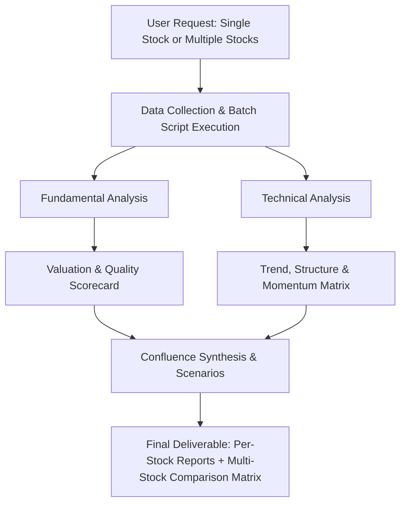

# Stock Analysis: Fundamental & Technical Confluence

This skill equips the agent with an institutional-grade, multi-dimensional equity analysis framework that integrates **Fundamental Analysis** (business quality, financial health, and valuation) with **Technical Analysis** (price action, market structure, trend momentum, and key support/resistance levels).

> **Core Philosophy**: Fundamentals identify *what* to buy or avoid (business value and safety margin); Technicals determine *when* and *at what price* to execute (market timing, trend alignment, and risk-reward structure).

---

## Analysis Workflow



### Phase 1: Data Acquisition
1. **Identify Ticker(s) & Asset Class**: Verify the ticker(s) across exchanges (e.g., US: `AAPL`, `NVDA`; HK: `0700.HK`; A-share: `600519.SS`, `603155.SS`, `002516.SZ`, `600893.SS`; Global/ETF: `SPY`, `QQQ`).
   - **Multi-Stock Input Support (多标的批量输入规范)**: When the user enters multiple stock names or tickers separated by commas,顿号 (`、`), spaces, or slashes (e.g., `/stock-analysis-report 新亚强、旷达科技、航发动力`), resolve the ticker for every requested stock and execute the analysis script for each stock so that every asset has its complete set of deliverables (`HTML`, `PDF`, `MD`, `PNG`, `JSON`) generated in its own subfolder.
2. **Execute Analysis Script**:
   Run the bundled automated analysis script to pull live historical market data, compute technical indicators, extract financial statements, and generate multi-format deliverables (Markdown, HTML, and PDF):
   ```bash
   uv run --with yfinance --with pandas --with matplotlib --with xhtml2pdf --with akshare python "G:/My Drive/Antigravity/Financial analysis/.agents/skills/stock-analysis-report/scripts/analyze_stock.py" --ticker <TICKER> --period 1y --name "<STOCK_NAME>"
   ```
   *Options:*
   - `--period`: `6mo`, `1y` (default), `2y`, `5y`
   - `--interval`: `1d` (default, Daily/日线), `1wk` (Weekly/周线), `1mo` (Monthly/月线)
   - `--output-dir`: Base directory for outputs (default: `./stock_analysis_output`)
   - `--subfolder`: Optional custom sub-folder name (default: auto-created `<STOCK_NAME> <TICKER>/`, e.g. `新亚强 603155.SS/` for Chinese equities, or `<TICKER>/` for global assets)
   - `--lang`: `auto` (default: outputs in English when the stock name/input is in English, and in Chinese when the stock name/input is in Chinese or a Chinese market asset), `zh` (force Chinese), or `en` (force English). Chat responses must match the same language rule: English stock names → English output; Chinese stock names → Chinese output.
   - `--name`: Optional explicit Chinese/English stock name (e.g. `--name "新亚强"`, `--name "腾讯控股"`). If omitted, automatically resolved in Chinese for Chinese market assets.
   - `--report-name`: Optional custom report filename base (e.g. `--report-name "新亚强"` -> `新亚强.html`, `新亚强.md`, `新亚强.pdf`). Defaults automatically to the resolved stock name (e.g. `新亚强.html`).

   *Chinese Stock Naming & Localization (中文证券名称规范与纯中文呈现系统):*
   For Chinese market assets (China A-Shares `.SS`/`.SZ`/`.BJ`, Hong Kong stocks `.HK`, and Chinese ADRs), the skill strictly enforces the use of authentic **Chinese stock names** (e.g., **新亚强** instead of Pinyin/uppercase English `XINYAQIANG SILICON CHEMISTRY CO`, **贵州茅台** instead of `KWEICHOW MOUTAI`, **腾讯控股** instead of `TENCENT HOLDINGS LTD`) across all chart titles, report headers, metadata cards, CLI logs, and JSON data. The script automatically queries real-time Chinese market APIs (Tencent Quote & EastMoney Search) to resolve the official Chinese name.
   
   *Chinese Reports English Minimization & Chinese Unit Standard (中文报告纯中文、禁用 B 单位与最小化英文规范):*
   When generating any report in Chinese mode (`lang == 'zh'`, covering both Chinese equities and global equities), strictly eliminate unnecessary English terms and English unit abbreviations across report headers, narratives, tables, parameters, and chart annotations:
   - **Chinese Financial Units (禁用 B，统一使用中文单位 亿)**:
     Never use `B` (Billion) for large amounts in Chinese reports regardless of currency (`USD`, `HKD`, `CNY`, etc.); always format using `亿` (`1e8` divisor, e.g. `$4028.36亿`, `$186.74亿`, `¥5.92亿`) and replace `N/A` / `None` with `暂无`.
   - **Header Metadata**:
     - `结算货币: 人民币` / `美元` / `港币` (strictly avoid raw codes like `CNY`, `CNH`, `USD`, or `HKD`).
     - `数据周期: 近1年` / `近2年` / `近6个月` (strictly avoid raw codes like `1y`, `2y`, `6mo`).
     - `时间级别: 日线级别` (strictly avoid appending `(Daily · 1D)`). Display once in the metadata row; do NOT duplicate it as an extra pill badge in the evaluation badges row below it.
     - `板块/行业: 基础材料 / 精细化工` (translate all sector and industry names into Chinese via `SECTOR_MAP_ZH` and `INDUSTRY_MAP_ZH`, strictly avoiding raw English like `Industrials` or `Aerospace & Defense`).
     - `分析日期: YYYY-MM-DD` (strictly format as pure date like `2026-11-01`, removing timestamps and seconds for visual cleanliness).
   - **Section Headers & Tables**:
     - `## 0. 公司主营业务概况` (never append `(Company Business Profile)`).
     - `## 一、核心结论与投研观点` (never append `(Executive Summary & Thesis)`).
     - `## 二、战术交易计划与执行矩阵` (never append `(Tactical Trade Setup)`).
     - Execution parameters: `防守止损线` (no `(Hard Stop)`), `第一目标位` / `第二目标位` (no `(Target 1)` / `(Target 2)`), `战术盈亏比` (no `(R:R)`).
     - Financial indicators: `市盈率 (TTM / 动态)`, `毛利率 / 营业利润率`, `自由现金流 / 自由现金流收益率`, `资产负债率` (no `(Debt/Equity)`), `股息率` (no `(Dividend Yield)`).
     - Scenario planning: `### 乐观情景 - 上行触发与催化` (no `(Bull Case)`), `### 悲观情景 - 下行风险与破位防守` (no `(Bear Case)`).
     - Technical indicators: `20日均线 (月线)`, `50日均线 (季线)`, `200日均线 (牛熊线)`, `布林通道 (20, 2σ)`, `成交量 (最新 / 20日均量)`.
   - **Chart Legends & Axes**:
     - Technical Chart: price axis formatted as `价格 (元)`, volume formatted as `成交量`, time axis formatted as `YYYY-MM` (avoiding English month names like `Nov`), moving averages formatted as `20日均线 / 50日均线 / 200日均线 (牛熊线)`.
     - PE Percentile Chart: multiples labeled in Chinese (e.g. `40.0倍`), oscillator tagged as `历史百分位振荡带 (%)`.
   
   *Typography & Readability Standards (字形与排版可读性规范):*
   All deliverables (`<STOCK_NAME>.md`, `<STOCK_NAME>.html`, `<STOCK_NAME>.pdf`) and charts adhere to institutional typography and formatting rules designed for maximum reading comfort:
   - **Font Hierarchy**: Microsoft YaHei / 微软雅黑 for Chinese characters and Segoe UI for alphanumeric figures, ensuring crisp, authentic font weights across browser HTML and PDF rendering.
   - **Reading Comfort**: Base body text set to `14.5px` with generous `1.7` line height and high-contrast deep slate palette (`#0f172a` on `#f8fafc` / `#ffffff`). Data tables feature `10px 14px` cell padding with `13.5px` font size and distinct zebra striping for effortless scanning.
   - **Standard Hyphen & Parenthesis Spacing Rule (统一使用半角连字符 - 与左括号前留空规范)**:
     Strictly use standard ASCII hyphen - instead of em-dash — across all numerical ranges, price intervals, trading setups, holding periods, dates, and title separators (e.g., ¥10.02 - ¥10.62, 2 - 8 周, [15.57倍 - 112.30倍], 乐观情景 - 上行触发与催化, 2021-2022). Always leave a space before an opening parenthesis `(` when preceded by text, numbers, or code (e.g., `20日线 (\$303.42)`, `Google (GOOGL)`).
   - **Stock Name Over Ticker Code in Prose (正文严格使用股票中文名称代替代码规范)**:
     Across all analytical narratives, executive thesis summaries, and technical market structure discussions, strictly use the **authentic Chinese stock name** (e.g. `航发动力`, `新亚强`, `旷达科技`) instead of raw alphanumeric ticker codes (e.g. `600893.SS`, `603155.SS`, `002516.SZ`). Alphanumeric codes are strictly reserved for the header banner and chart titles where identification is needed; all prose and body sentences must read naturally with the company name (e.g. `从市场微观结构剖析，航发动力 呈现典型波段博弈特征...` and `航发动力 机构综合评级为...`).
   - **Bracket & Parenthesis Minimization Standard (极简化去除【】与（）规范)**:
     To maximize reading fluency, institutional authority, and visual cleanliness, strictly minimize the use of `【】` and `（）` across all titles, narratives, table headers, and badges:
     - **No Brackets in Section & Block Titles**: Use solid category pills or clean bullets (e.g. `▌ 行业格局与竞争壁垒剖析：`, `▌ 近3年业绩趋势与盈利研判：`, `▌ 估值定价与机构共识：`) instead of heavy square brackets like `【行业格局...】`. Section 3 titles use natural middle-dots: `三、多周期技术分析图表 · 日线级别` instead of `(【日线级别】)`.
     - **No Brackets Around Strategic Terms**: Remove brackets around trading bias (e.g. `战术操作定性为 防御观望 / 破位规避` rather than `【防御观望 / 破位规避】`), and remove brackets around sector names (e.g. `深耕 基础材料 / 精细化工 核心赛道` rather than `【基础材料...】`).
     - **Flowing Prose Over Parentheses**: Convert narrative parenthetical qualifications into natural, flowing clauses with commas and conjunctions:
       - Financial trajectories: e.g. `公司2025年营收 ¥5.92亿，同比 -17.9%，2年营收复合增速 -6.4%；归母净利润 ¥0.82亿，同比 -28.4%` instead of `（同比-17.9%，2年营收复合增速为 -6.4%）`.
       - Margin shifts: e.g. `毛利率由 20.7% 回升至 20.5%，较上年微调 -0.3%` instead of `（微调-0.3%）`.
       - Trade setups: e.g. `第一上行目标看向 ¥13.39，预期盈亏比 1 : 2.05` instead of `（预期盈亏比 1 : 2.05）`.
     - **Clean Header Badges & Tables**: Eliminate parenthetical clutter in rating badges and table headers:
       - Badges: `技术面: 弱势空头下行 · 1/5` and `基本面: 基本面稳健 · 3/5` instead of `(1/5)` or `(存在部分周期或估值压力) (3/5)`.
       - Confluence: `D类：高风险双杀 · 建议规避` instead of `（基本面恶化且趋势下行，建议规避）`.
       - Table headers & metrics: `2025年最新`, `同比变动 YoY`, `2年复合变动 CAGR/差值`, `净资产收益率 ROE`, `经营活动现金流 OCF`, `自由现金流 FCF`, `市盈率 (TTM / 动态)`.
   - **Unified Percentage Notation (统一使用 % 符号规范)**:
     Across all comparison tables (specifically including YoY and 2-year multi-period changes for Gross Margin, Operating Margin, Net Profit Margin, and ROE) and fundamental analytical narratives, strictly unify all percentage and margin differences with the `%` symbol (e.g. `-0.3%`, `+1.5%`, `-4.0%`), strictly prohibiting text descriptors such as `百分点`.

   *Historical PE Percentile & Valuation Bands (PE 历史百分位与估值带宽):*
   All deliverables automatically compute 3-year, 5-year, and 10-year (or full listing history) daily historical PE (TTM) percentiles, benchmark bands ($P_{10}, P_{25}, P_{50}, P_{75}, P_{90}$), historical valuation minimum/maximum/median, and institutional 5-zone status classification (极度低估、价值配置、合理中枢、估值偏高、极度高估/警戒).
   - **Executive Summary KPI Anchor (开头估值速览)**: The 10-year historical PE percentile is prominently positioned as the primary valuation anchor (e.g. `市盈率与历史分位: 40.0倍 (10年分位: 80.3%) | 估值偏高区`).
   - **Core Financial Metrics Matrix (核心财务指标矩阵)**: Explicitly displays the complete horizon `PE 历史分位数 (3年 / 5年 / 10年)` alongside the 10-year historical valuation range $[Min - Max]$ and median ($P_{50}$).
   - **Dedicated Visualizer**: Generates a 2-panel valuation chart `<ticker>_pe_percentile_chart.png` with collision-free layout, upper executive valuation status card, and right-aligned benchmark pill badges. For China A-Shares, exact daily valuation series from EastMoney (东方财富) are automatically extracted via `akshare`; for global stocks, an implied valuation series is derived.

   *Company Business Profile (公司主营业务概况):*
   Every report automatically extracts and features an official, concise description of the company's core operations at the very opening (before or introducing the Executive Summary). For Chinese equities or reports generated in Chinese mode (`lang == 'zh'`), the profile strictly mandates authentic Chinese text extracted via official domestic sources (EastMoney HTTPS F10 Company Survey API or akshare TongHuaShun `stock_zyjs_ths` fallback), strictly prohibiting raw English text fallbacks. For global equities in Chinese mode, an institutional Chinese profile synthesized from industry classification is provided.

   *Time Scale (Daily / Weekly) & Chart Labeling:*
   All 4 chart panels and report deliverables explicitly label the active time scale (for Chinese equities, purely label as `【日线级别】` or `【周线级别】`; for global equities, `【日线级别 (Daily · 1D)】` or `【周线级别 (Weekly · 1W)】`). Moving average labels adapt dynamically (`20日均线` vs. `20周均线`), each subplot features dedicated top-right corner indicator tags (`[P1] 价格`, `[P2] 成交量`, `[P3] RSI`, `[P4] MACD`), and the active timeframe is presented cleanly once in the report metadata header without redundant pill badges in the lower evaluation verdict strip.
   
   *Output Organization & Directory Naming (输出目录与文件规范):*
   Each execution automatically creates a dedicated sub-folder under `stock_analysis_output/<STOCK_NAME> <TICKER>/` (for Chinese equities, e.g. `stock_analysis_output/新亚强 603155.SS/`) or `stock_analysis_output/<TICKER>/` (for global assets) containing:
   - `<ticker>_chart.png` (High-res 4-panel technical chart: Price/MAs/BB, Volume, separated RSI (14), and MACD (12,26,9))
   - `<ticker>_pe_percentile_chart.png` (Institutional 2-panel 10-year / max-history PE (TTM) valuation band & percentile oscillator chart)
   - `<ticker>_data.json` (Structured metrics & confluence scoring)
   - `<STOCK_NAME>.html` (Standalone, responsive HTML report named with the stock name, e.g. `新亚强.html`)
   - `<STOCK_NAME>.md` (Full markdown analysis report named with the stock name, e.g. `新亚强.md`)
   - `<STOCK_NAME>.pdf` (Print-ready PDF report named with the stock name, e.g. `新亚强.pdf`)
   - *(Note: Redundant duplicate aliases such as `report.html`, `report.md`, and `report.pdf` are strictly disabled per user preference; deliverables are cleanly named exclusively with the asset name, e.g. `新亚强.html`, `新亚强.md`, `新亚强.pdf`)*

3. **Execute Multi-Stock Horizontal Comparison Script (多标的投资对比研判独立报告生成)**:
   Whenever **2 or more stocks** are analyzed in a single request, after generating the individual stock reports, run `compare_stocks.py` to generate a standalone **投资对比研判报告** in its own separate sub-folder:
   ```bash
   uv run --with yfinance --with pandas --with numpy --with matplotlib --with mplfinance --with xhtml2pdf --with requests python "G:/My Drive/Antigravity/Financial analysis/.agents/skills/stock-analysis-report/scripts/compare_stocks.py" --tickers <TICKER_1> <TICKER_2> <TICKER_3> --output-dir "./stock_analysis_output"
   ```
   *Dedicated Multi-Stock Comparison Folder & Deliverables:*
   Creates a separate folder `stock_analysis_output/投资对比研判报告 - <Stock1>_<Stock2>_.../` (e.g. `stock_analysis_output/投资对比研判报告 - 新亚强_旷达科技_航发动力/`) containing:
   - `<Stock1>_<Stock2>_..._投资对比研判报告.html` (Standalone responsive HTML comparison dashboard with a two-line header banner placing stock names on a dedicated `.header-stocks` line below the title, priority KPI cards, 11-row core quantitative & fundamental matrix, 7-column tactical trade setup matrix, and institutional priority ranking cards; strictly omits redundant embedded chart galleries so the comparison report stays focused and compact)
   - `<Stock1>_<Stock2>_..._投资对比研判报告.pdf` (Mobile-adapted `112mm x 220mm` smartphone vertical PDF edition of the comparison report with a two-line header banner, vertically stacked KPI cards, dimension-grouped comparison blocks, vertical tactical trade cards, and full-width priority recommendation cards)
   - `<Stock1>_<Stock2>_..._投资对比研判报告.md` (Full Markdown horizontal comparison report)
   - `comparison_data.json` (Structured ranking scores, priority recommendations, and deliverable paths)
   - **Automatic TTM Alignment for Heterogeneous Fiscal Year-Ends**: When compared equities have different latest annual fiscal year-ends (e.g., Jan-end FY26 vs. Dec-end FY25) and TTM fields (`total_revenue_ttm`, `net_income_ttm`) are present in `<ticker>_data.json`, `compare_stocks.py` automatically aligns Revenue, Net Income, Gross Margin/ROE, Operating Cash Flow, and Priority Recommendations on **TTM (Trailing Twelve Months)** across all deliverables for an apples-to-apples comparison.

---

### Phase 2: Fundamental Dissection

Evaluate whether the business is high quality, fairly priced, and financially resilient across three structured pillars:

1. **Industry Landscape, Competitive Positioning & Moat (行业格局与竞争壁垒剖析)**:
   - **Sector & Supply Chain Positioning**: Identify core industry vertical, upstream raw materials sensitivity, and downstream customer stickiness.
   - **Institutional Moat & Qualifications**: Extract single-champion designations (工信部制造业单项冠军), specialized entry qualifications (e.g. strategic defense engine assembly credentials, Tier-1 automotive OEM approvals, high-purity silane formulation moats), and proprietary R&D patents.
   - **Industry Lifecycle & Cyclical Phase**: Categorize active macro cycle (e.g. cyclical supply/demand capacity rebalancing & bottoming out for materials/chemicals, secular defense modernization for aerospace/machinery, NEV smart cockpit penetration for automotive parts).
2. **Multi-Year Business Performance Trend & Profitability Trajectory (近3年业绩趋势与盈利研判)**:
   - **Audited 3-Year Trajectory**: Systematically compare 3 years of audited financials ($T-2, T-1, T$) covering Total Revenue, Net Income, Gross Margin, Operating Margin, ROE, Operating Cash Flow (OCF), and Free Cash Flow (FCF).
   - **Compounding & Momentum**: Compute latest YoY growth rates and 2-year Compound Annual Growth Rate (2Y CAGR) for top-line revenue and bottom-line earnings.
   - **Margin Dynamics & Bottom Resilience**: Evaluate whether gross margin is expanding, contracting under cost inflation, or stabilizing at cyclical bottoms.
   - **Cash Flow Durability & Earnings Quality**: Verify whether Operating Cash Flow (OCF) exceeds net income ($OCF \ge Net\ Income$), validating cash collection health and supply-chain working capital safety.
3. **Profitability, Financial Health & Solvency (盈利质量与资产负债健康度)**:
   - Capital Efficiency: Return on Equity (ROE), Return on Invested Capital (ROIC), and **Dividend Yield (股息率)**.
   - Solvency & Liquidity: Total Debt/Equity (< 120% is conservative), Current/Quick Ratios, and interest coverage.
4. **Valuation Multiples & Historical Percentile Band (估值定价与机构共识)**:
   - Multiples: Trailing P/E, Forward P/E, PEG Ratio (< 1.5 indicates GARP), Price/Sales, Price/Book, EV/EBITDA.
   - **PE Historical Percentile (3-Year / 5-Year / 10-Year)**: Compute daily historical PE (TTM) percentiles across 3Y, 5Y, and 10Y lookback windows against $P_{10}, P_{25}, P_{50}, P_{75}, P_{90}$ benchmarks. The 10-year percentile serves as the primary headline anchor in executive summary scorecards. Classify valuation into 5 institutional zones (Deep Value $<20\%$, Accumulation $20\%-40\%$, Fair Core $40\%-60\%$, Elevated $60\%-80\%$, Overvaluation Hazard $>80\%$).
   - **Cyclical Stock PE Trap Protocol**: For cyclical assets (chemicals, chips, shipping, metals), distinguish true undervaluation from cycle-trough passive PE explosion; cross-reference with PB percentile, normalized mid-cycle earnings, and replacement value.
   - Sell-Side Consensus & Target Price: Compare current price against analyst consensus mean target price and ratings.
5. **Catalysts & Risks**:
   - Next earnings announcement date, macro rate environment, industry supply-demand shifts, regulatory scrutiny.

*Refer to [Fundamental Metrics Reference](references/fundamental-metrics.md) for benchmark ranges across sectors.*

---

### Phase 3: Technical & Price Action Analysis

Evaluate trend direction, momentum, market structure, and key price reaction zones:

1. **Market Structure & Trend State**:
   - **Trend Definition**: Determine whether price makes Higher Highs / Higher Lows (Uptrend), Lower Highs / Lower Lows (Downtrend), or is Range-bound (Consolidation).
   - **Moving Average Alignment**:
     - *Short-term*: 20 SMA / 21 EMA (momentum baseline).
     - *Medium-term*: 50 SMA (institutional benchmark pullback zone).
     - *Long-term*: 200 SMA (secular bull/bear line).
     - *Key Signals*: Golden Cross (50 crosses above 200) vs. Death Cross (50 crosses below 200).
2. **Momentum & Volatility**:
   - **Relative Strength Index (RSI - 14)**:
     - Bullish regime: Oscillating between 40 and 80; pullbacks bouncing near 40-50.
     - Bearish regime: Oscillating between 20 and 60; rallies rejecting near 50-60.
     - Bearish/Bullish Divergence: Price making new highs while RSI makes lower highs (warning of trend exhaustion).
   - **MACD (12, 26, 9)**: Signal line crossovers, MACD histogram expansion/contraction, and zero-line positioning.
   - **Bollinger Bands (20, 2σ)**: Band squeeze (anticipating volatility breakout) vs. walking the bands (strong trend).
3. **Volume & Key Price Levels**:
   - **Volume Confirmation**: High volume on breakout days; contracting volume during pullbacks/consolidations (indicates healthy absorption).
   - **Support & Resistance**: Historical horizontal inflection zones, previous pivot highs/lows.
   - **Fibonacci Retracements**: Key pullback levels (38.2%, 50%, 61.8% of previous impulse leg).

*Refer to [Technical Indicators Reference](references/technical-indicators.md) for formulas and edge cases.*

---

### Phase 4: Technical & Fundamental Confluence

Combine both perspectives into a 4-quadrant verdict:

| Technical State \ Fundamental State | Strong Fundamentals (High Quality & Growth) | Weak Fundamentals (High Debt, Declining Margins) |
| :--- | :--- | :--- |
| **Bullish Trend (Above 50/200 SMA, High Momentum)** | **Category A: High-Probability Compunder**<br>Institutional accumulation; trend following; buy pullbacks to 20/50 SMA. | **Category B: Speculative / Momentum Squeeze**<br>Technical rally not supported by earnings; treat as short-term trade only; trail stops tightly. |
| **Bearish Trend (Below 50/200 SMA, Lower Lows)** | **Category C: Potential Value Opportunity**<br>Quality company on sale; wait for technical reversal / base formation before accumulating. | **Category D: Value Trap / Capitulation**<br>Deteriorating business and capital outflow; avoid or hedge. |

*Refer to [Confluence Framework Reference](references/confluence-framework.md) for detailed risk/reward scoring.*

---

### Phase 5: Institutional Deliverable Structure

When executing the skill or presenting findings to the user, ensure all institutional-grade components are delivered across `<STOCK_NAME>.md`, `<STOCK_NAME>.html`, and `<STOCK_NAME>.pdf`:

1. **Company Business Profile & Core Operations (公司主营业务概况)**:
   - Positioned prominently at the very opening of the report (before or heading into the Executive Summary).
   - Provides an authoritative 2-3 sentence overview of company history, core products (including single champion designations), downstream applications, and competitive moat.
2. **Executive Summary & Investment Thesis (核心投研观点与概要)**:
   - Confluence Rating & Badge (Technical score /5, Fundamental score /5, Confluence Category A/B/C/D).
   - 4-Card KPI Strip:
     - *Price & Daily Change*: Last close, daily return %, 52W High Drawdown % & 52W Low Rebound %.
     - *Valuation & Historical Percentile*: P/E (TTM), 10Y PE Percentile headline anchor, Valuation Zone.
     - *Capital Returns & Quality (资本回报与质量)*: **ROE, Operating Margin, YoY Revenue Growth, and Dividend Yield (股息率)**.
     - *Trend & Volatility*: RSI(14), ATR(14), Key Support & Resistance levels.
   - **Simple & Readable Executive Thesis (简单易读的【核心投研观点】标准)**:
     - *Eliminate dense walls of text*: Strictly avoid monolithic, unformatted text blocks or robotic repetition of quantitative scores.
     - *Two-tier structured format*:
       1. 📌 **一句话定性研判 (Bottom Line Summary)**: 1-sentence high-signal conclusion identifying the company's confluence category, tactical operating bias, latest price, and trend channel state.
       2. 🔍 **四维核心逻辑拆解 (4 Key Thesis Pillars in Bullets)**:
          - 📊 **走势与形态 (Trend & Momentum)**: 52-week drawdown/rebound, moving average pressure/support, momentum oscillator regime (RSI/MACD), and key floor support level.
          - 🏢 **基本面分析 (Fundamental Analysis & Moat)**: Core industry vertical, champion credentials / qualifications moat, multi-year revenue & profit trends (YoY growth), gross margin dynamics, and operating cash conversion durability.
          - 💰 **估值与质地 (Valuation & Quality)**: PE multiple & 10Y historical percentile band (explaining cyclical valuation dynamics where applicable), ROE capital return, and dividend yield cash safety buffer.
          - 🎯 **战术与风控 (Tactical Execution & Risk Control)**: Operating bias, accumulation zone, structural invalidation stop loss, price target, and risk-to-reward ratio.
3. **Tactical Trade Setup & Execution Matrix**:
   - Tactical Bias: *Bullish / Buy on Pullbacks*, *Range-Bound / Accumulation*, or *Defensive / Wait for Base*.
   - Recommended Accumulation Zone (support retest or moving average pullback band).
   - Hard Invalidation Stop Loss (structural breakdown floor).
   - Target 1 (Primary swing target / immediate resistance).
   - Target 2 (Runner / 52-week high breakout target).
   - Mathematically computed Risk-to-Reward Ratio ($R:R$).
   - Expected Holding Time Horizon (e.g. 2 - 8 Weeks).
4. **Multi-Pane Technical Chart**:
   - High-resolution 4-panel visualization (Price + 20/50/200 MAs + Bollinger Bands, Volume + 20 SMA, dedicated RSI 14 oscillator panel with 30/70 thresholds, and dedicated MACD 12/26/9 signal & histogram panel).
   - Embedded directly as Base64 in HTML (`<STOCK_NAME>.html`) and referenced in Markdown and PDF.
5. **Technical Market Structure & Quantitative Breakdown**:
   - Microstructural narrative (MA stack dynamics, momentum oscillator state, volume participation).
   - Full indicator table with calculated values and interpretive signals.
6. **Fundamental Quality, Valuation & Moat Analysis (基本面估值、盈利质量与护城河)**:
   - **Structured 3-Part Fundamental Deep-Dive Box (结构化三大基本面深度研判)**:
     1. **▌ 行业格局与竞争壁垒剖析：** Sector/industry vertical context, supply-chain positioning, national single-champion/high-entry qualification moats, and industry lifecycle/cyclical stage.
     2. **▌ 近3年业绩趋势与盈利研判：** Multi-year financial trajectory, top-line & bottom-line growth (YoY & 2Y CAGR), gross margin trend dynamics, ROE quality, and operating cash flow (OCF) conversion soundness.
     3. **▌ 估值定价与机构共识：** Trailing P/E multiple against 10-year historical percentile anchor, cyclical valuation digestion vs. margin of safety, and sell-side consensus target price.
   - Comprehensive Financial Scorecard: Market Cap, EV, P/E, Forward P/E, PEG, P/S, P/B, EV/EBITDA, Gross & Operating Margins, ROE, FCF & FCF Yield %, YoY Revenue Growth, Debt-to-Equity, Dividend Yield, and Analyst Consensus Target.
   - **Past 2-Year Performance Comparison Matrix (近3年核心经营业绩与财务对比矩阵)**: Full multi-year comparison table covering revenue, operating profit, net income, margins, ROE, cash flows, latest YoY changes, and 2-year CAGR.
   - 10-Year PE (TTM) Percentile Band visualizer and historical multiple range $[Min - Max]$ and median.
   - *For Commodities/Macro assets*: Structured 4-pillar macro factor breakdown (TIPS Real Yields, DXY, Central Bank Physical Accumulation, Sovereign Debt/Geopolitical Risk).
7. **Scenario Planning: Bull Case vs. Bear Case**:
   - Explicit side-by-side comparison of upside catalysts vs. downside risks and invalidation triggers.
8. **Key Catalysts & Monitoring Checklist**:
   - Concrete events, resistance tests, and macro prints to track.
9. **Institutional Compliance & Disclaimer**:
   - Explicit disclaimer regarding educational and research purposes.

10. **Mobile-Adapted Smartphone PDF Specification (手机端原生适配套件规范)**:
   - **Vertical Mobile Viewport**: Page dimensions set to `112mm x 220mm` (~9:18 vertical aspect ratio), closely matching modern iOS (iPhone 13-16 series 19.5:9) and Android (20:9) mobile screen proportions. Allows 1:1 reading in WeChat, Feishu, DingTalk, Acrobat, and mobile system readers without pinch-to-zoom or horizontal panning.
   - **Word-Safe Text Wrapping & Boundary Defense (全词同行不拆分与自动换行规范)**:
     - English reports omit `-pdf-word-wrap: CJK` and `word-break: break-all`, relying on native word-level wrapping (`word-wrap: break-word`) so English words are always kept whole on the same line (never split mid-word such as `d` / `eep`). Chinese reports use `-pdf-word-wrap: CJK` paired with a word-boundary-safe `xhtml2pdf`/`ReportLab` patch so CJK text wraps seamlessly at margins while embedded English words/tickers stay unbroken on the same line and `<br/>` line breaks are preserved.
     - **Header Rating Badges Stack & Optical Vertical Centering (顶部评级胶囊标签垂直居中规范)**: Rating badges (`技术面`, `基本面`, `战术定性`) in the top banner transform into a vertically stacked table layout (`td style="padding: 1.5px 0;"`). To counter ReportLab / CJK font baseline metrics (where Chinese glyphs sit high with excess bottom descent), badges enforce optical vertical centering (`padding: 3.4px 8px 1.5px 8px; line-height: 1.0; vertical-align: middle;`), ensuring the white text is optically and geometrically dead-center within the colored pill badge with equal top and bottom color margins.
     - **Company Business Profile (公司主营业务概况)**: Long profile paragraphs wrap seamlessly across lines within the blue-accented container.
     - **Optimized Institutional Body Typography (主体文字字号与排版标准)**: All body narratives, analytical commentary, investment thesis summaries, profile descriptions, and checklist points enforce enlarged institutional reading sizes (Mobile Single-Stock PDF: base body 9.8pt, narratives & profile 9.0pt, thesis points & checklist 8.8pt, section subtitles 9.3pt - 9.6pt, table cells 7.3pt - 7.8pt; Mobile Comparison PDF: base body 9.2pt, KPI & dimension blocks 8.3pt - 8.8pt, recommendation body 8.8pt; Desktop HTML: base body 15.5px, narratives 14.5px - 15.5px, table cells 14.5px), ensuring effortless readability on modern high-DPI smartphone screens and desktop PDF viewers.
   - **Balanced 2x2 KPI Grid**: Transforms the 4-card KPI strip into a 2x2 grid (`最新价格 & 涨跌`, `估值与历史分位`, `资本回报与质量`, `动能与波动率`) with bold headline figures (`12.5pt - 13pt`) and compact sub-metrics.
   - **Full-Width Stacked Scenarios**: Bull and Bear scenario cards stack vertically at 100% width, eliminating cramped multi-column text wrap and highlighting catalysts and risks cleanly.
   - **Generous Section Title Distance & Spacing (各章节段落标题上方留出空行与舒适间距规范)**: Every primary section title (`h2`) enforces a generous top separation (`margin: 16px 0 5px 0; padding-top: 4px; border-bottom: 1.5px solid #cbd5e1;`) and subsection titles (`h3`) enforce `margin: 12px 0 4px 0;` (with module wrapper containers enforcing `margin-top: 14px; margin-bottom: 6px;`). This guarantees clear, comfortable breathing room above every heading, preventing title crowding.
   - **Strict Column Budgeting**: Multi-year financial comparison tables enforce explicit percentage column widths (`th style="width: 26%;"`) and compact cell padding (`2.5px 3.5px`) to prevent metric overlapping.
   - **True Full-Bleed Charts**: Technical analysis and 10-year PE percentile charts scale to edge-to-edge mobile width (`width="370"`), preventing `xhtml2pdf` percentage sizing glitches.
   - **Disclaimer Spacing (免责声明紧凑页脚规范)**:
     The bottom legal/regulatory disclaimer enforces a clean top separation (`margin-top: 16px; padding-top: 8px; border-top: 1px solid #cbd5e1;`), avoiding unnecessary trailing blank pages.
   - **Continuous Gap-Free Mobile Flow & Fundamentals-First Order (无强制分页符与基本面前置流式排版规范)**:
     - **No Forced Page Breaks (去除页间强制空白)**: Forced `<div style="page-break-before: always;"></div>` breaks are removed in both single-stock mobile PDFs and mobile comparison PDFs so content flows continuously from page to page with minimal blank space.
     - **Mobile Comparison PDF Structure**: Uses the `112mm x 220mm` vertical viewport with a two-line header banner (report title on line 1, stock names on a dedicated `.header-stocks` line), vertically stacked KPI cards, dimension-grouped comparison blocks, 2x2 vertical tactical trade cards, and full-width priority recommendation cards.
     - **Fundamentals-First Section Order (基本面前置于技术图表)**: Section 3 presents `基本面估值、盈利质量与护城河` (including 10-year PE (TTM) historical valuation bands & 3-year performance matrix), followed by Section 4 (`多周期技术分析图表`) and Section 5 (`技术面深度剖析与微观量价结构`).
     - **Heading & Row Defense**: Enforces `h1, h2, h3, h4 { page-break-after: avoid; }` and `tr, .chart-container, img, .kpi-table, .company-profile-box, .confluence-box, .trade-setup-card, .scenario-table { page-break-inside: avoid; }` across all pages to prevent isolated titles or bisected cards/rows.

---

### Phase 6: Chat Response & Multi-Stock Horizontal Comparison Style (对话端输出规范与多标的横向对比研判模板)

When presenting analysis results in chat, strictly follow the two standardized output templates below depending on whether **1 stock** or **multiple stocks (2+)** are requested.

#### 6.1 Single-Stock Chat Response Style (单标的对话输出规范)

When a single stock is analyzed, present a clean, 3-part institutional summary:
1. **`### 一、主营业务与核心结论`**:
   - `> **公司概况**：...` (2-3 sentence summary of core track, main products, and single-champion / strategic moat).
   - `- 📌 **一句话定性研判**：...` (identifying confluence category, technical/fundamental scores, tactical bias, latest price, and MA alignment).
   - **4-Row Core Metrics Table** (`| 核心维度 | 当前数值 | 机构对标与关键观察 |`):
     - `**最新现价 & 过去一年位置**`
     - `**市盈率与历史分位**` (PE (TTM), 10Y percentile, median, 10Y range `[Min - Max]`, valuation zone)
     - `**盈利回报与资产负债**` (ROE, Dividend Yield, P/B, debt/cash cushion)
     - `**趋势动能与波幅**` (14D RSI, ATR, 20/50/200 MA values, volume/MACD status)
2. **`### 二、四维核心逻辑拆解`**:
   - `- **走势与形态**：...`
   - `- **基本面与经营周期**：...`
   - `- **估值与质地**：...`
   - `- **战术交易与风控矩阵**：` (nested bullets for `操作倾向`, `关注布局区间`, `防守止损线`, `第一 / 第二目标位 & 战术盈亏比`)
3. **`### 三、交付报告与图表文件清单`**:
   - Clickable `file:///` links to `<STOCK_NAME>.html`, `<STOCK_NAME>.pdf`, `<STOCK_NAME>.md`, `<ticker>_chart.png`, `<ticker>_pe_percentile_chart.png`, and `<ticker>_data.json`.

---

#### 6.2 Multi-Stock Horizontal Comparison & Configuration Priority Style (多标的横向对比与配置研判输出规范)

When the user enters **multiple stock names or tickers** (e.g., `/stock-analysis-report 新亚强、旷达科技、航发动力`), first run `analyze_stock.py` for every stock so each stock has its own updated deliverables, then output the **Multi-Stock Horizontal Comparison & Portfolio Allocation Report** in the exact 4-section structure below:

##### Section 1: `#### 1. 核心量化与基本面横向对比矩阵`
Construct an 11-row side-by-side Markdown table comparing all requested stocks (`| 对比维度 | **股票A** (代码) | **股票B** (代码) | **股票C** (代码) |`), ordered from highest allocation priority to lowest:

| 对比维度 | **股票A** (`代码`) | **股票B** (`代码`) | **股票C** (`代码`) |
| :--- | :--- | :--- | :--- |
| **核心赛道与壁垒** | 核心主业 + 第二曲线<br>核心资质 / 护城河壁垒 | 核心主业 / 细分领域<br>单项冠军 / 全产业链配套壁垒 | 核心主业 / 国家战略定位<br>专营总装资质与准入壁垒 |
| **最新现价 / 过去一年回撤** | **¥X.XX**（距高点 `-XX.X%`） | **¥XX.XX**（距高点 `-XX.X%`） | **¥XX.XX**（距高点 `-XX.X%`） |
| **技术面 / 基本面评分** | 技术面 `X/5` \| 基本面 `X/5` | 技术面 `X/5` \| 基本面 `X/5` | 技术面 `X/5` \| 基本面 `X/5` |
| **机构共振评级** | **X类：评级定性描述** | **X类：评级定性描述** | **X类：评级定性描述** |
| **PE (TTM) 与10年分位** | **XX.X倍**（10年分位 **XX.X%** · 估值分区）<br>*补充3年/5年分位或估值特征说明* | **XX.X倍**（10年分位 **XX.X%** · 估值分区）<br>*补充周期底部被动推高PE等说明* | **XXX.X倍**（10年分位 **XX.X%** · 估值分区）<br>*补充动态PE、P/S等辅助锚点* |
| **市净率 P/B** | **X.XX倍** | **X.XX倍** | **X.XX倍** |
| **最新年度营收及增速** | **¥XX.XX亿**（同比 `+X.X%`，2Y复合 `+XX.X%`） | **¥X.XX亿**（同比 `-XX.X%`，2Y复合 `-X.X%`） | **¥XXX.XX亿**（同比 `-X.X%`，2Y复合 `+X.X%`） |
| **最新年度归母净利及增速** | **¥X.XX亿**（同比 `+XX.X%`） | **¥X.XX亿**（同比 `-XX.X%`） | **¥X.XX亿**（同比 `-XX.X%`） |
| **毛利率 / 净资产收益率 ROE** | 毛利率 **XX.X%**（`+X.X%`）\| ROE **X.X%** | 毛利率 **XX.X%**（`-X.X%`）\| ROE **X.X%** | 毛利率 **X.X%**（`-X.X%`）\| ROE **X.X%** |
| **经营现金流 OCF / 负债结构** | OCF **¥X.XX亿**（FCF收益率 `X.XX%`）<br>有息负债率 `X.X%` | OCF **¥X.XX亿**（保持正流入）<br>**零有息负债**（现金 ¥XX.XX亿） | OCF **¥-XX.XX亿**（备货与结算占用）<br>有息债务权益比 `XX.X%` |
| **股息率安全垫** | **X.XX%** | **X.XX%** | **X.XX%** |

##### Section 2: `#### 2. 战术交易点位与风控对比`
Construct a 7-column tactical trade execution matrix comparing entry zones, hard stops, targets, R:R ratios, and microstructural triggers across all stocks:

| 标的 | 战术操作倾向 | 建议逢低关注区间 | 防守止损线 | 第一 / 第二目标位 | 战术盈亏比 | 关键技术观察点 |
| :--- | :--- | :--- | :--- | :--- | :--- | :--- |
| **股票A** | 操作定性 | `¥X.XX - ¥X.XX` | **¥X.XX** | **¥X.XX / ¥X.XX** | `1 : X.XX` | 量价异动特征、支撑位与20/50/200日均线突破/收复观察点 |
| **股票B** | 操作定性 | `¥XX.XX - ¥XX.XX` | **¥XX.XX** | **¥XX.XX / ¥XX.XX** | `1 : X.XX` | 缩量/放量特征、前低支撑承接与关键均线阻力位 |
| **股票C** | 操作定性 | `¥XX.XX - ¥XX.XX` | **¥XX.XX** | **¥XX.XX / ¥XX.XX** | `1 : X.XX` | 均线粘合带压制或支撑防守观察点 |

##### Section 3: `#### 3. 机构综合排序与配置建议`
Rank the analyzed stocks into an actionable institutional priority hierarchy with clear role labels and right-side/left-side execution triggers:
1. **`首选关注（基本面与估值/量价匹配度最优）：<股票A>`**
   - `- **核心优势**：...` (Highlight multi-metric earnings/cashflow expansion, 3Y/5Y/10Y PE percentile safety margin, FCF yield, strategic catalysts, and the exact moving average or price level for right-side entry).
2. **`次选防御（高股息与净现金周期反转 / 弹性次优）：<股票B>`**
   - `- **核心优势**：...` (Highlight balance sheet fortress such as zero debt, net cash buffer, high dividend yield floor, cyclical trough passive PE explanation, and left-side/right-side observation triggers).
3. **`审慎观望（战略壁垒极高但短期财务与估值承压 / 趋势待修复）：<股票C>`**
   - `- **核心特征**：...` (Acknowledge long-term monopoly/moat, explain short-term margin compression, passive PE elevation, or low R:R ratio, and specify the exact breakout level or fundamental inflection required before entry).

##### Section 4: `#### 4. 横向对比报告与各标的交付文件清单`
Provide compact, clickable `file:///` links to the standalone `投资对比研判报告` report folder deliverables first, followed by each individual stock's deliverables:
- **投资对比研判报告（独立目录）**：📄 [股票1_股票2_股票3_投资对比研判报告.html](file:///...) ｜ 📱 [股票1_股票2_股票3_投资对比研判报告.pdf](file:///...) ｜ 📝 [股票1_股票2_股票3_投资对比研判报告.md](file:///...) ｜ 🗂️ [comparison_data.json](file:///...)
- **股票A（`代码`）**：📄 [股票A.html](file:///...) ｜ 📱 [股票A.pdf](file:///...) ｜ 📝 [股票A.md](file:///...) ｜ 📊 [技术图表](file:///...) ｜ 📈 [PE分位图](file:///...)
- **股票B（`代码`）**：📄 [股票B.html](file:///...) ｜ 📱 [股票B.pdf](file:///...) ｜ 📝 [股票B.md](file:///...) ｜ 📊 [技术图表](file:///...) ｜ 📈 [PE分位图](file:///...)
- **股票C（`代码`）**：📄 [股票C.html](file:///...) ｜ 📱 [股票C.pdf](file:///...) ｜ 📝 [股票C.md](file:///...) ｜ 📊 [技术图表](file:///...) ｜ 📈 [PE分位图](file:///...)
